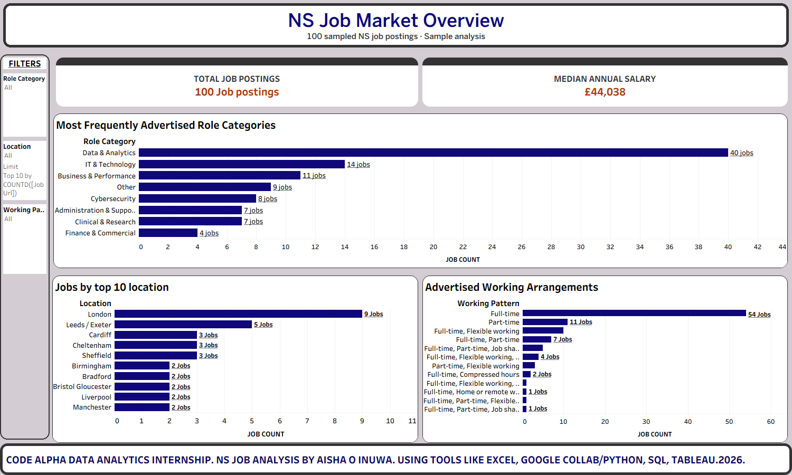
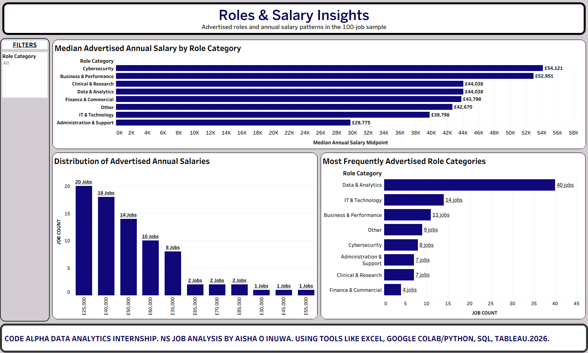
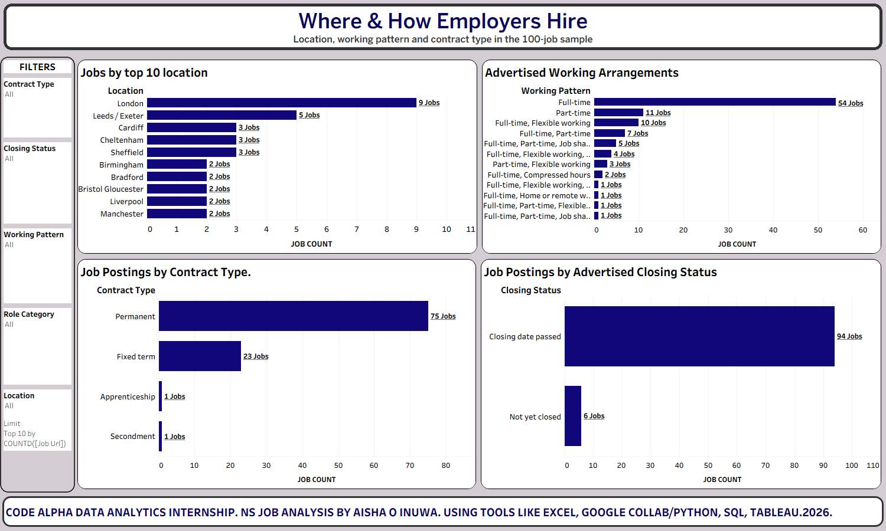

# 🏥 NS Job Market Analysis: Web Scraping, SQL & Tableau

> **What do UK healthcare "Data Analyst" job adverts actually look like?** I scraped 100 of them, cleaned the mess, interrogated them with SQL, and turned the answers into three Tableau dashboards.

**CodeAlpha Data Analytics Internship Project** · by **Aisha O. Inuwa** · 2026


---

## 📑 Table of Contents

1. [The 60-second version](#-the-60-second-version)
2. [Why I built this](#-why-i-built-this)
3. [Project objectives](#-project-objectives)
4. [The dashboards](#-the-dashboards)
5. [What I found, objective by objective](#-what-i-found-objective-by-objective)
6. [Recommendations](#-recommendations)
7. [How it works (the pipeline)](#-how-it-works-the-pipeline)
8. [What's in this repo](#-whats-in-this-repo)
9. [Run it yourself](#-run-it-yourself)
10. [Honest limitations](#-honest-limitations)
11. [What I learned](#-what-i-learned)
12. [Project deliverables](#-project-deliverables)
13. [CodeAlpha tasks covered](#-codealpha-tasks-covered)
14. [About me](#-about-me)

---

## ⚡ The 60-second version

| | |
|---|---|
| **Question** | What do data and analytics jobs look like in a public UK healthcare jobs board, and what should a job seeker target? |
| **Data** | 100 live job adverts scraped from a public UK healthcare jobs board (adverts posted 7 Sep to 2 Oct 2026) |
| **Tools** | Python (Requests, BeautifulSoup, pandas) · Excel · PostgreSQL + DBeaver · Tableau |
| **Output** | A clean dataset, a tested SQL script with reusable views, and 3 interactive dashboards |
| **Headlines** | **40%** of adverts are Data & Analytics roles · median advertised salary **£44,038** · **82%** of data roles are permanent · only **6%** of all adverts list home or remote working, and **none** of the 40 data roles do |

---

## 💡 Why I built this

Job adverts are public, but they're scattered across hundreds of pages, written in free text and wildly inconsistent. A salary might be `£32,073 to £39,043 a year per annum`, `£14.50 to £16.40 an hour`, or just *nothing at all*.

I wanted to turn that chaos into something a job seeker could actually use: *Which roles are in demand? What do they pay? Where are they? Is any of it flexible? What kind of contract is on offer?*

It also gave me a chance to practise the **whole** analytics workflow in one project: collect → clean → query → visualise → explain (including the limits of what the data can say).

---

## 🎯 Project objectives

| # | Objective | The question it answers | Where to look |
|---|---|---|---|
| **1** | **Job-seeker opportunity** | What characteristics of data and analytics jobs can help job seekers target promising international opportunities? | [Findings](#objective-1--job-seeker-opportunity) |
| **2** | **Demand** | Which data and analytics roles are most frequently advertised? | Dashboards 1 & 2 |
| **3** | **Compensation** | What salary levels are associated with these opportunities? | Dashboards 1 & 2 |
| **4** | **Work location** | Where are these opportunities concentrated? | Dashboards 1 & 3 |
| **5** | **Work flexibility** | How prevalent are remote, hybrid/flexible and on-site working arrangements? | Dashboards 1 & 3 |
| **6** | **Employment type** | What contract structures are employers offering? | Dashboard 3 |

Objectives 2 to 6 are answered directly by the data. **Objective 1 pulls them together** into a practical profile for job seekers, and it comes with an honest caveat: the adverts don't say whether an employer sponsors visas or welcomes overseas applicants, so "promising" here means *favourable characteristics you can see in the data*, which you then verify in the full advert.

---

## 📊 The dashboards

Three dashboards. Each one has filters so you can slice the data yourself in Tableau.

### 1. NS Job Market Overview (objectives 2, 4, 5)
*"Give me the big picture."* Total postings, median salary, the most advertised role categories, top locations and working arrangements.



### 2. Roles & Salary Insights (objectives 2, 3)
*"Who pays what?"* Median advertised annual salary by role category, how salaries are distributed, and which roles show up most.



### 3. Where & How Employers Hire (objectives 4, 5, 6)
*"Where are the jobs, and on what terms?"* Locations, advertised working patterns, contract types and closing-date status.



> 🧭 The interactive workbook is in [`tableau/NS_Job_Market_Dashboards.twbx`](tableau/NS_Job_Market_Dashboards.twbx). Open it in Tableau Desktop or Tableau Public.

---

## 🔍 What I found, objective by objective

Everything below describes **this sample of 100 adverts** (see [limitations](#-honest-limitations)). Every number can be re-created by running [`src/objectives_summary.py`](src/objectives_summary.py) on the CSV.

### Objective 2 · Demand
*Which data and analytics roles are most frequently advertised?*

**Answer: Data & Analytics is the biggest category by far, but half of it is support-level work.**

| Role category (all 100 adverts) | Adverts | Share |
|---|---:|---:|
| **Data & Analytics** | **40** | **40%** |
| IT & Technology | 14 | 14% |
| Business & Performance | 11 | 11% |
| Other | 9 | 9% |
| Cybersecurity | 8 | 8% |
| Administration & Support | 7 | 7% |
| Clinical & Research | 7 | 7% |
| Finance & Commercial | 4 | 4% |

Looking *inside* the 40 Data & Analytics adverts (my own grouping of job titles):

| Job family | Adverts | Share of data roles |
|---|---:|---:|
| Administration, assistant & coordination | 12 | 30% |
| **Analyst** (information, data, EHR, HIM…) | **11** | **28%** |
| Lead / manager | 5 | 12% |
| Data quality & validation | 5 | 12% |
| **Data engineering** | **4** | **10%** |
| Governance & protection | 2 | 5% |
| Clinical coding | 1 | 2% |

So the three "career-track" families (analyst, engineering, lead/manager) make up **20 of the 40** data adverts, and the rest are administration, data-quality and governance roles. Categories and families are my own groupings, **not** official job classifications.

### Objective 3 · Compensation
*What salary levels are associated with these opportunities?*

**Answer: about £44,000 at the median, but pay depends heavily on the type of role.**

- **79 of 100** adverts had a usable *annual* salary range (1 was hourly, and **20 showed no salary at all**).
- **Median advertised salary midpoint: £44,038** (mean £45,513; range about £25,737 to £85,557).
- Data & Analytics sits exactly on the overall median at **£44,038** (30 salaried adverts; **10 of the 40** showed no salary).
- By pay level (79 adverts): **20** under £30,000, **28** from £30,000 to £49,999, **31** at £50,000 or more.

| Data & Analytics job family | Salaried adverts | Median salary midpoint |
|---|---:|---:|
| Data engineering | 4 | **£57,045** |
| Governance & protection | 2 | £52,588 |
| Analyst | 11 | **£44,700** |
| Lead / manager | 3 | £42,670 |
| Data quality & validation | 4 | £28,196 |
| Administration, assistant & coordination | 6 | £26,618 |

Across all role categories, the highest medians are **Cybersecurity (£54,121)** and **Business & Performance (£52,951)**, and the lowest are **Administration & Support (£29,775, 3 adverts)** and **IT & Technology (£39,798)**. Small groups swing a lot, so read those as hints, not rules.

### Objective 4 · Work location
*Where are these opportunities concentrated?*

**Answer: they aren't concentrated. London leads, but only just.**

- **London: 9 adverts (9%)**, then **Leeds / Exeter (5)**, and **Cardiff, Cheltenham and Sheffield (3 each)**.
- The **top 10 locations cover only 33 adverts**. The 100 adverts use **76 different location labels**, and **65 of them appear just once**.
- Within the 40 data roles: **London 4**, then **Bradford, Cardiff and Cheltenham (2 each)**; the 40 roles come from **35 different employers**, and only 5 employers have two or more.

Location is free text typed by the employer (e.g. `Leeds / Exeter`, `Bristol Gloucester`), so grouping is approximate.

### Objective 5 · Work flexibility
*How prevalent are remote, hybrid/flexible and on-site working arrangements?*

**Answer: flexibility is a minority feature, and explicit remote working is rare.**

| Working arrangement (from the advert's working-pattern field) | All 100 | Data & Analytics (40) |
|---|---:|---:|
| Home or remote working listed | **6 (6%)** | **0 (0%)** |
| Flexible working listed (no remote) | 22 (22%) | 7 (18%) |
| No flexibility listed (standard hours, assumed on-site) | 72 (72%) | 33 (82%) |

- **54** adverts are plain *Full-time*; **28** mention *Part-time* as an option.
- The 6 adverts listing home or remote working are *Performance Analyst*, *Senior Finance Analyst*, *Senior Business Analyst*, *Remote Senior Clinical Coding Analyst* and two *Clinical Audit Assistant* roles, so **no data-category role lists remote**.
- ⚠️ The advert form has **no "hybrid" or "on-site" option**. "Flexible working" is the closest signal to hybrid, and "no flexibility listed" is the closest signal to on-site. Neither confirms where you will actually work.

### Objective 6 · Employment type
*What contract structures are employers offering?*

**Answer: mostly permanent contracts.**

| Contract type | All 100 | Data & Analytics (40) |
|---|---:|---:|
| Permanent | **75 (75%)** | **33 (82%)** |
| Fixed term | 23 (23%) | 7 (18%) |
| Secondment | 1 | 0 |
| Apprenticeship | 1 | 0 |

### Objective 1 · Job-seeker opportunity
*What characteristics of data and analytics jobs can help job seekers target promising international opportunities?*

**Answer: the most promising profile in this sample is a permanent, career-track data role paid £40,000 or more. Remote working is rare, so remote-first seekers should widen the search to analyst roles outside the data category.**

| Characteristic | What the data shows | Why it helps a job seeker |
|---|---|---|
| **Role level** | Analyst, engineering and lead/manager roles (20 of 40) pay a median of £42,670 to £57,045; admin and data-quality roles pay £26,618 to £28,196 | Aim for the career-track families |
| **Pay** | **18 of the 40** data adverts are paid £40,000 or more | A clear shortlist of higher-paying roles |
| **Contract** | **15 of those 18** are permanent; 82% of all data roles are permanent | Stability is the norm |
| **Flexibility** | Only **3 of the 18** list flexible working and **0** list remote | Don't expect remote from the higher-paid data roles |
| **Where remote does appear** | 4 analyst-titled adverts (performance, finance, business, clinical coding) list home or remote working | Worth including in a remote-focused search |
| **Employers** | 35 employers for 40 roles | No single hiring hub; apply widely |
| **Timing** | Typical advert open for **14 days**; 86 of 100 closed within 3 weeks of posting | Be ready to apply quickly |

⚠️ **What the data cannot tell you:** whether any employer sponsors visas, accepts applicants who live abroad, or allows work from another country. None of that is in the scraped fields, so confirm it in each full advert and on official government and employer guidance before applying.

### ⏳ Closing dates (data quality check)
Closing dates ran from **4 Oct to 30 Nov 2026**. On the dashboard refresh date (**27 Oct 2026**), **94** had passed and **6** were not yet closed. This split changes every day because it is calculated against today's date. Every advert has a closing date, so the `Closing date unavailable` category in the SQL view is empty (0 adverts).

---

## 💡 Recommendations

Based on patterns in this sample (not guarantees about every vacancy), here is what I would suggest to a job seeker targeting data and analytics roles:

1. **Aim for career-track roles.** Analyst, engineering and lead roles pay a median of roughly £43,000 to £57,000; administration and data-quality roles sit at roughly £27,000 to £28,000. (Objectives 2, 3)
2. **Prioritise permanent roles, but keep fixed-term in view.** 82% of data roles are permanent, and the 18% that are fixed-term can still be a way in. (Objective 6)
3. **Don't expect remote work from data-category roles.** None of the 40 listed it. If remote matters, also search analyst roles in business, finance and clinical coding, where 4 of the 6 remote-listed adverts sit. (Objective 5)
4. **Search more than one job title.** Many data jobs are called *information analyst*, *data quality* or *data engineer* rather than *data analyst*. (Objective 2)
5. **Open the advert when no salary is shown.** 20 of 100 adverts (10 of 40 data roles) had no salary in the listing. (Objective 3)
6. **Apply early.** The typical advert stayed open for about 14 days. (Objective 1)
7. **Look beyond London.** London had 9 adverts, but 65 of 76 location labels appear only once. (Objective 4)
8. **Check eligibility yourself.** The data does not say whether an employer sponsors visas or accepts applicants based abroad. Confirm it in the full advert. (Objective 1)

For the reasoning and full tables, see [`docs/04_insights_report.md`](docs/04_insights_report.md).

---

## 🛠️ How it works (the pipeline)

```
 Public jobs website
        │   Python: Requests + BeautifulSoup (10 search pages → 100 adverts)
        ▼
 Raw scraped data
        │   pandas + Excel: tidy text, split salary, label Annual/Hourly, add role category
        ▼
 data/ns_data_analyst_jobs_100.csv
        │   PostgreSQL (via DBeaver): load table → build reusable views
        ▼
 vw_ns_jobs_clean → analysis views → vw_ns_jobs_tableau
        │   Tableau connects to the final view
        ▼
 3 dashboards
```

### Step 1: Web scraping 🕷️
I collected the advert links from 10 pages of search results, then visited each advert to grab: job title, employer, location, postcode, salary, posting date, closing date, contract type, working pattern and URL. The scraper waits a second between requests and carries on if one page misbehaves.

### Step 2: Cleaning 🧹
- Trimmed messy whitespace in every text field.
- Split salary text into `salary_min`, `salary_max` and a midpoint.
- Labelled every salary **Annual**, **Hourly** or **Not available**, so that £14.50 an hour never gets averaged with £40,000 a year.
- **Kept missing salaries as missing** rather than turning them into zero (zero would quietly wreck every average).
- Converted dates and created the role categories.

### Step 3: SQL 🗄️
The script builds one foundation view (`vw_ns_jobs_clean`) and then small, focused views on top of it: salary analysis, location demand, working arrangements, contract types, role demand, a jobseeker summary, and a row-level view for Tableau. Medians use `PERCENTILE_CONT(0.5)`, because medians don't get dragged around by a few very high salaries the way averages do.

### Step 4: Dashboards 📈
Tableau connects to `vw_ns_jobs_tableau` and presents the findings with filters for role category, location, working pattern, contract type and closing status.

---

## 📁 What's in this repo

```
CodeAlpha_NSJobMarketAnalysis/
│
├── README.md                         ← you are here 👋
├── requirements.txt                  ← Python packages needed
├── LICENSE                           ← MIT (code) + data note
├── .gitignore
│
├── data/
│   └── ns_data_analyst_jobs_100.csv ← the cleaned dataset (100 rows, 16 columns)
│
├── notebooks/
│   └── 01_ns_jobs_scraping_and_cleaning.ipynb  ← my full working-out, mess and all
│
├── src/
│   ├── ns_jobs_pipeline.py          ← the tidy, re-runnable version of the notebook
│   └── objectives_summary.py        ← re-computes every number used for the six objectives
│
├── sql/
│   └── ns_jobs_analysis.sql         ← table, views and analysis queries (PostgreSQL)
│
├── tableau/
│   └── NS_Job_Market_Dashboards.twbx
│
├── dashboards/                       ← PNG exports of the three dashboards
│   ├── 01_ns_job_market_overview.png
│   ├── 02_roles_and_salary_insights.png
│   └── 03_where_and_how_employers_hire.png
│
└── docs/
    ├── 01_methodology.md             ← every cleaning/classification decision explained
    ├── 02_data_dictionary.md         ← what each of the 16 columns means
    ├── 03_sql_guide.md               ← a plain-English tour of the SQL views
    ├── 04_insights_report.md         ← findings, insights and recommendations, with the numbers
    ├── 05_known_issues_and_next_steps.md
    ├── 06_refreshing_the_dashboards.md  ← how to refresh Tableau after data changes
    └── 07_submission_checklist_and_linkedin.md  ← CodeAlpha submission steps + LinkedIn post draft
```

**Notebook vs script?** The notebook is the honest journey: I tested ideas, hit errors and fixed them. The script is the clean route you'd actually re-run. Both give the same results; I checked the script's cleaning against all 100 rows of the dataset.

---

## 🚀 Run it yourself

### Option A: Just explore the results (2 minutes)
1. Open the [dashboard images](#-the-dashboards) above, or
2. Download `tableau/NS_Job_Market_Dashboards.twbx` and open it in Tableau Public (free).

### Option B: Re-run the SQL
1. Install PostgreSQL (and optionally DBeaver) and create a database.
2. Open `sql/ns_jobs_analysis.sql`; the header explains each step.
3. Run the `CREATE TABLE`, load `data/ns_data_analyst_jobs_100.csv` into it (`\copy` in psql, or *Import Data* in DBeaver), then run the rest of the script.

You should see **100 jobs, 79 with annual salary, and a median of £44,038.**

### Option C: Re-run the scraper
```bash
git clone https://github.com/Aishainuwa600dataanalyst/CodeAlpha_NSJobMarketAnalysis.git
cd CodeAlpha_NSJobMarketAnalysis

python -m venv .venv
source .venv/bin/activate        # Windows: .venv\Scripts\activate
pip install -r requirements.txt

# quick test: 2 pages only
python src/ns_jobs_pipeline.py --pages 2 --out data/test_run.csv

# full run: 10 pages (~100 adverts)
python src/ns_jobs_pipeline.py
```

> ⚠️ Live job adverts change daily, so a fresh scrape will give **different** adverts from the ones in this repo. Please read the website's terms of use first and keep the delay between requests.

---

## ⚖️ Honest limitations

Good analysis says what it *can't* tell you, too.

- **Small, non-random sample.** 100 adverts from the first 10 pages of a relevance-ranked search. It does not represent the whole UK healthcare job market.
- **A keyword search is a blunt tool.** Searching "Data Analyst" also surfaced a Salaried GP, a receptionist and a call handler. I kept them in the sample and put them in *Other* / *Administration*.
- **Pay figures are advertised ranges**, not take-home pay or what anyone is actually offered. 20 adverts had no salary at all.
- **Small groups, big swings.** Some categories have very few salaried adverts (Administration has 3; Finance has 4), so their medians shouldn't be over-read. Cybersecurity's median is also lifted by four adverts from one national employer that share one salary band.
- **"Flexible" does not mean "remote", and "hybrid"/"on-site" aren't recorded.** Only 6 adverts explicitly say home or remote working, and the advert form has no hybrid or on-site field, so I use "flexible working listed" and "no flexibility listed" as the closest proxies.
- **Job families and flexibility groups are analysis-time groupings** (rules in `src/objectives_summary.py`). They are not columns in the CSV or fields in the dashboards.
- **Nothing here confirms visa sponsorship** or eligibility for applicants outside the UK, so Objective 1 can only describe favourable characteristics, not guaranteed international opportunities.
- **Naming and data-use note.** In this repo the project is called "NS Job Market Analysis" and the source is described generically as a public UK healthcare jobs board. This project is independent and has no affiliation with, or endorsement from, any employer or the job board. The advert text and employer names belong to the advertisers, the data was collected for learning and portfolio purposes only, and anyone re-running the scraper should read the site's terms of use first.
- **A future closing date is not proof the vacancy is open.**
- **Role categories are mine.** They come from keyword rules on job titles, so a few adverts are debatable. (I found and fixed one rule bug along the way: [details here](docs/05_known_issues_and_next_steps.md).)

---

## 🎓 What I learned

This project helped me practise the complete analytics workflow: collecting data, cleaning and validating it, writing SQL queries, creating reusable analytical views, building dashboards and communicating findings with appropriate limitations. It also reinforced the importance of checking filters, missing values and salary units before drawing conclusions from visualisations.

The big lessons:

- **Check your units before you chart.** One hourly salary mixed into an annual average would have quietly distorted everything.
- **Missing data is information.** 20% of adverts had no salary, and that's a finding in its own right.
- **Verify the dashboard against the source.** When one view showed only 33 postings, I traced it back to the top-10 location filter, not an error. Cross-checking every chart against the SQL saved me from a false alarm *and* from real mistakes.
- **Classification rules need testing.** Keyword matching is quick but sneaky: my `"it "` rule for IT jobs also matched the end of "Aud**it**", so audit roles were filed under IT until I caught it.
- **Communicate the caveats.** A number without its limitations is only half an insight.

---

## 📦 Project deliverables

- [x] Python web-scraping notebook ([`notebooks/`](notebooks/)) and a clean script ([`src/`](src/))
- [x] Cleaned job-posting dataset ([`data/`](data/))
- [x] PostgreSQL SQL script and analytical views ([`sql/`](sql/))
- [x] Tableau workbook ([`tableau/`](tableau/)) and dashboard exports ([`dashboards/`](dashboards/))
- [x] Findings, insights, recommendations and documentation ([`docs/`](docs/))

---

## ✅ CodeAlpha tasks covered

| CodeAlpha task | How this project covers it |
|---|---|
| **Task 1: Web Scraping** | Python scraper (Requests + BeautifulSoup) collecting 100 public job adverts into a custom dataset |
| **Task 2: Exploratory Data Analysis** | Data-quality checks, missing-value handling, salary-unit separation, trends in roles, pay, locations and contracts |
| **Task 3: Data Visualization** | Three interactive Tableau dashboards telling a clear story for jobseekers |

---

## 👩🏾‍💻 About me

**Aisha O. Inuwa**: Healthcare & Program Data Analyst

🔗 GitHub: [Aishainuwa600dataanalyst](https://github.com/Aishainuwa600dataanalyst)  
💼 LinkedIn: [Aisha Inuwa](https://www.linkedin.com/in/aisha-inuwa-879145312)

If you have feedback, spot something I could do better, or want to chat about healthcare data, I'd love to hear from you. 💜

---

*Completed as part of the CodeAlpha Data Analytics Internship. Findings describe the collected sample only and are not a comprehensive assessment of healthcare recruitment.*
